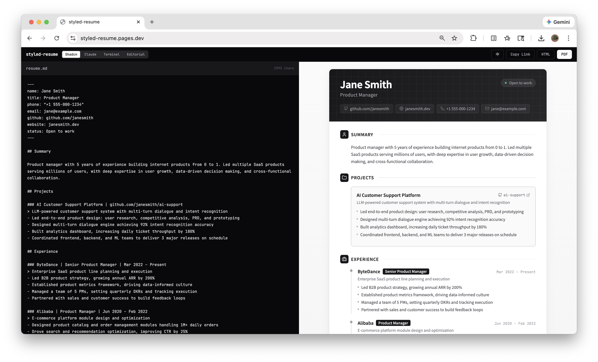

# styled-resume

用 Markdown 写简历，获得有设计感的输出。

[](LICENSE)
[](https://react.dev)
[](https://www.typescriptlang.org)

[English](README.md)

<!-- TODO: 添加在线 Demo 链接 -->
<!-- [在线体验](https://your-demo-url.com) -->

## 预览

<!-- TODO: 替换为实际截图 -->
<!--  -->

| Shadcn | Claude | Terminal | Editorial |
|--------|--------|----------|-----------|
| 简洁极简 | 温暖专业 | 复古黑客 | 报纸编辑 |

> 截图即将补充。先 clone 到本地跑起来看效果。

## 这是什么？

大多数 Markdown 简历工具的输出千篇一律。styled-resume 不一样 — 它让你的 Markdown 变成真正有设计感的简历。

一份 Markdown，四种视觉风格。一键切换模板，导出 PDF 或 HTML，或者生成一个分享链接让别人直接在浏览器里查看。

## 功能

- **4 套设计模板** — Shadcn（简洁）、Claude（温暖）、Terminal（复古）、Editorial（报纸 Bento Grid）
- **实时预览** — 左边写 Markdown，右边即时看到效果
- **PDF 导出** — 浏览器端单页连续 PDF，无需服务器
- **HTML 导出** — 下载自包含 HTML 文件，部署到任何地方
- **分享链接** — 生成压缩 URL，对方打开就能看到你的简历
- **自动保存** — 内容自动存储到 localStorage

## 快速开始

```bash
git clone https://github.com/YUHAO-corn/styled-resume.git
cd styled-resume
npm install
npm run dev
```

打开 `http://localhost:5174` 开始编辑。

## 工作原理

```
Markdown  →  解析器  →  模板渲染  →  PDF / HTML / 分享链接
                          ↑
                     4 种视觉风格
```

用简单的 Markdown 结构写简历（姓名、职位、经历、项目、技能等），解析器将其转为结构化数据，模板引擎用你选择的风格渲染输出。

## 技术栈

React · Vite · TypeScript · Tailwind CSS · lz-string

## 许可证

MIT © [YUHAO-corn](https://github.com/YUHAO-corn)
